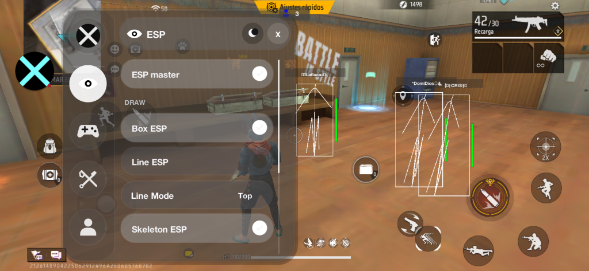
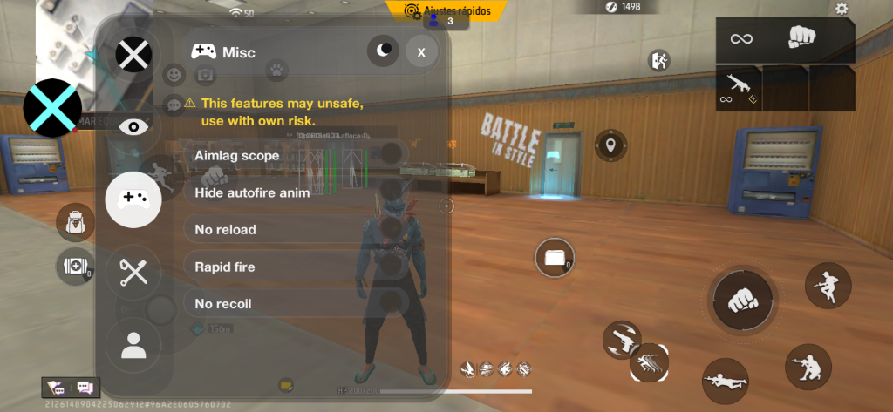

# FLUCK V1.0.0

**Free Fire — IFix patch package for iOS**

[](https://github.com/bnxyung2008g/Fluckv1-3105/releases/tag/v1.0.0)
&nbsp;

&nbsp;

&nbsp;


---

## Capturas de pantalla

| ESP | Aimbot | Aimbot (cont.) | Misc |
|-----|--------|----------------|------|
|  |  |  |  |

---

## ¿Qué es esto?

FLUCK V1.0.0 es un archivo `.3105` para Free Fire (`com.dts.freefireth`, `Assembly-CSharp 0.86.0.518`). Aplica un parche IFix que reemplaza cuatro métodos del juego en tiempo de ejecución sin modificar el binario principal del juego. Incluye un tema visual oscuro con logo X personalizado y no requiere contraseña.

> **Este repositorio no es Full Source.** Contiene el disassembly del parche IFix (tipos, campos ofuscados, bytecode en base64 cifrado) y scripts de personalización de colores y logo. No incluye código C# legible ni decompilado.

---

## Instalación

### Requisitos
- Dispositivo iOS con [Scarlet](https://usescarlet.com) o [TrollStore](https://github.com/opa334/TrollStore)
- Free Fire instalado (`com.dts.freefireth`)

### Pasos
1. Descarga `FLUCK V1.0.0.3105` desde la [sección Releases](https://github.com/bnxyung2008g/Fluckv1-3105/releases/tag/v1.0.0)
2. Abre Scarlet (o la app parcheadora que uses) e importa el archivo `.3105`
3. Aplica el parche sobre la instalación existente de Free Fire
4. Abre Free Fire — el menú aparece automáticamente al iniciar una partida

> El archivo `.3105` es un paquete `3105PATCH` cifrado con AES-GCM que reemplaza internamente el archivo `assembly-csharp-patch` del juego. No modifica el IPA ni el binario principal.

---

## Opciones del menú

Las siguientes opciones son visibles en las capturas de pantalla (`previe/`). **Ninguna de estas opciones puede agregarse, eliminarse ni reordenarse** — la estructura del menú está fijada en el bytecode IFix cifrado y no es editable desde los archivos de este repositorio.

**ESP** — solo visibles, no personalizables
- ESP master (toggle principal)
- Box ESP
- Line ESP
- Line Mode (Top)
- Skeleton ESP

**Aimbot** — solo visibles, no personalizables
- Aimbot
- Silent
- Target Part (Head)
- Auto Fire
- Show FOV Circle
- Aim Target Line
- FOV Size (150 px)
- Aim Range (150 m)

**Misc** — solo visibles, no personalizables
- Aimlag scope
- Hide autofire anim
- No reload
- Rapid fire
- No recoil

---

## Qué sí puedes modificar

### 1. Colores del panel

`SOURCE/COLORS_EDIT.py` reemplaza 7 secuencias de color directamente en el binario IFix (búsqueda y reemplazo de bytes IEEE-754 en el stream `Ldc_R4`). `SOURCE/07_color_map.txt` documenta las 59 secuencias de color con sus offsets exactos.

| Constante | RGBA original | Qué controla |
|-----------|--------------|--------------|
| `COLOR_FONDO_PANEL` | `(0.06, 0.03, 0.12, 0.96)` | Fondo principal del panel |
| `COLOR_ACTIVO` | `(0.85, 0.55, 1.00, 1.00)` | Feature activa / acento |
| `COLOR_BTN_INACTIVO` | `(0.045, 0.065, 0.10, 0.95)` | Fondo de botón inactivo |
| `COLOR_HEADER` | `(0.07, 0.085, 0.11, 0.92)` | Barra superior |
| `COLOR_DORADO` | `(1.00, 0.76, 0.30, 1.00)` | Acento secundario dorado |
| `COLOR_PANEL_OSCURO` | `(0.12, 0.13, 0.15, 0.85)` | Fondos de sección interior |
| `COLOR_ROJO_ALERTA` | `(0.96, 0.20, 0.22, 1.00)` | Estado activo / alerta |

### 2. Logo del botón flotante

`scripts/inject_x_v3.py` y `scripts/fix_circle.py` generan un ícono X (fondo negro circular, trazo blanco, 128×128 px) y lo inyectan en los slots de string `408` y `800` del IFix (almacenados como base64 dentro del binario).

> **Dependencias externas requeridas** (no incluidas en este repositorio):
> - `ifix_codec` — parser del formato IFix (ruta local hardcodeada en los scripts)
> - `cryptography` — para AES-GCM
> - `Pillow` — para generar la imagen del logo

---

## Qué NO puedes hacer desde este repositorio

| Limitación | Motivo |
|-----------|--------|
| Agregar o eliminar opciones del menú | Estructura compilada en el IFix vault cifrado |
| Cambiar el layout o las pantallas del menú | Parte del bytecode IFix, no disponible en forma editable |
| Leer la lógica de las funciones (ESP, Aimbot, etc.) | El bytecode está cifrado; `SOURCE/04_strings.txt` tiene 1 188 strings en base64 encriptado |
| Ejecutar los scripts directamente | Dependen de `ifix_codec` que no está incluido |

---

## Métodos parcheados por el IFix

Según `SOURCE/01_fixes.txt`, el parche modifica exactamente 4 métodos:

| # | Clase | Método |
|---|-------|--------|
| 0 | `COW.GameFacade` | `get_UIModelRole` |
| 1 | `COW.GamePlay.Player` | `IsReallyInStealth` |
| 2 | `COW.GamePlay.Player` | `get_LastAimingInfoFromWeapon` |
| 3 | `COW.GamePlay.SceneEditBoxSelectTool` | `OnGUI` |

---

## Estructura del repositorio

```
Fluckv1-3105/
├── output/
│   └── FLUCK V1.0.0.3105              ← Archivo listo para instalar (~3.97 MB)
├── previe/
│   ├── preview_esp.png
│   ├── preview_aimbot.png
│   ├── preview_aimbot2.png
│   └── preview_misc.png
├── scripts/
│   ├── inject_x_v3.py                 ← Inyecta logo X en el binario IFix
│   ├── fix_circle.py                  ← Variante del logo (puntas más delgadas)
│   └── decrypt_vault.py               ← Intento de descifrado del vault (experimental)
├── SOURCE/
│   ├── 00_summary.txt                 ← Metadatos IFix: offset, tamaño, conteos
│   ├── 01_fixes.txt                   ← Los 4 métodos parcheados
│   ├── 02_types.txt                   ← 117 tipos referenciados
│   ├── 03_extern_methods.txt          ← 214 llamadas externas
│   ├── 04_strings.txt                 ← 1 188 strings (base64 cifrado)
│   ├── 05_fields.txt                  ← 404 campos (nombres ofuscados)
│   ├── 06_bytecode_raw.txt            ← Bytecode de los 215 métodos
│   ├── 07_color_map.txt               ← 59 secuencias de color con offsets
│   ├── COLORS_EDIT.py                 ← Editor de colores del panel
│   ├── README_COLORES.md              ← Guía del editor de colores
│   └── assembly-csharp-patch-*.bytes  ← Versiones intermedias del binario
└── README.md
```

---

## Autor y contacto

**Dev @BNXYUNG7**

[](https://t.me/projectbnxyung7)
[](https://instagram.com/justin17._m)
[](https://discord.gg/projectbnxyung7)
[](https://guns.lol/0071)

---

## ⚠️ Aviso

Proyecto educativo e investigativo. Úsalo únicamente en dispositivos y cuentas de tu propiedad. El uso en partidas en línea puede resultar en sanciones permanentes por parte del desarrollador del juego.
