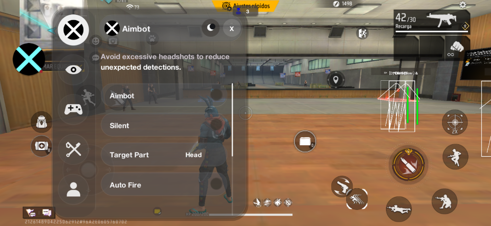
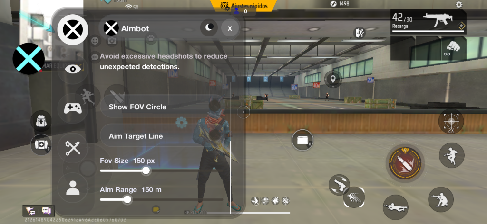

# FLUCK V1.0.0

**Free Fire — IFix patch package for iOS**

<div align="center">

| ESP Menu | Aimbot Menu | Aimbot Settings | Misc Menu |
|----------|-------------|-----------------|-----------|
|  |  |  |  |

[](https://github.com/bnxyung2008g/Fluckv1-3105/releases/tag/v1.0.0)
&nbsp;
**3.97 MB · No password · iOS**

</div>

---

## Descripción

FLUCK V1.0.0 es un archivo `.3105` para Free Fire (`com.dts.freefireth`, versión `Assembly-CSharp 0.86.0.518`). Aplica un parche IFix que reemplaza cuatro métodos del juego en tiempo de ejecución sin modificar el binario principal. Incluye un tema visual oscuro personalizado y un logo de botón tipo X, sin protección con contraseña.

**Lo que contiene el repositorio** es el disassembly del parche IFix, scripts de personalización de colores y de logo, y el archivo `.3105` listo para usar. **No contiene código fuente C#** ni decompilación legible del juego.

---

## Archivo de salida

| Archivo | Tamaño | Formato |
|---------|--------|---------|
| `output/FLUCK V1.0.0.3105` | ~3.97 MB | Paquete `3105PATCH` (IFix + plist binario, AES-GCM) |

El paquete apunta a la ruta del juego:
```
Documents/contentcache/Compulsory/ios/gameassetbundles/codepatch/
  assembly-csharp-patch.T0mFTHJhcvgBJrIRhg8bEapnUTM~3D
```

---

## Opciones del menú

Visibles en las capturas de pantalla incluidas en `previe/`.

**ESP** (`previe/preview_esp.png`)
- ESP master (toggle principal)
- Box ESP
- Line ESP
- Line Mode — Top
- Skeleton ESP

**Aimbot** (`previe/preview_aimbot.png`, `previe/preview_aimbot2.png`)
- Aimbot
- Silent
- Target Part — Head
- Auto Fire
- Show FOV Circle
- Aim Target Line
- FOV Size (150 px)
- Aim Range (150 m)

**Misc** (`previe/preview_misc.png`)
- Aimlag scope
- Hide autofire anim
- No reload
- Rapid fire
- No recoil

> Estas opciones son las que muestra el menú en ejecución. No es posible agregar, eliminar ni reordenar opciones desde los archivos de este repositorio — la estructura del menú está fijada en el bytecode IFix.

---

## Métodos parcheados

El disassembly IFix (`SOURCE/01_fixes.txt`) registra exactamente **4 métodos** modificados:

| # | Clase | Método |
|---|-------|--------|
| 0 | `COW.GameFacade` | `get_UIModelRole` |
| 1 | `COW.GamePlay.Player` | `IsReallyInStealth` |
| 2 | `COW.GamePlay.Player` | `get_LastAimingInfoFromWeapon` |
| 3 | `COW.GamePlay.SceneEditBoxSelectTool` | `OnGUI` |

El bytecode de estos métodos está cifrado en el IFix vault. El repositorio no incluye una versión descifrada ni código fuente legible de su lógica.

---

## Personalización disponible

### Colores del panel

`SOURCE/COLORS_EDIT.py` permite remplazar **7 secuencias de color** directamente en el binario IFix (búsqueda y reemplazo exacto de bytes IEEE-754 en el stream de instrucciones `Ldc_R4`). `SOURCE/07_color_map.txt` contiene las 59 secuencias de color completas con sus offsets exactos.

Los colores editables con sus valores originales son:

| Constante | RGBA original | Descripción |
|-----------|--------------|-------------|
| `COLOR_FONDO_PANEL` | `(0.060, 0.030, 0.120, 0.96)` | Fondo principal del panel |
| `COLOR_ACTIVO` | `(0.850, 0.550, 1.000, 1.00)` | Feature activa / acento |
| `COLOR_BTN_INACTIVO` | `(0.045, 0.065, 0.100, 0.95)` | Fondo de botón inactivo |
| `COLOR_HEADER` | `(0.070, 0.085, 0.110, 0.92)` | Barra superior |
| `COLOR_DORADO` | `(1.000, 0.760, 0.300, 1.00)` | Acento secundario dorado |
| `COLOR_PANEL_OSCURO` | `(0.120, 0.130, 0.150, 0.85)` | Fondos de sección interior |
| `COLOR_ROJO_ALERTA` | `(0.960, 0.200, 0.220, 1.00)` | Estado activo / alerta |

> **Nota:** El script opera sobre el binario extraído del `.3105` (`assembly-csharp-patch.T0mFTHJhcvgBJrIRhg8bEapnUTM~3D`) y requiere una dependencia externa (`ifix_codec`) que **no está incluida** en este repositorio.

### Logo del botón flotante

`scripts/inject_x_v3.py` y `scripts/fix_circle.py` generan un logo X (fondo negro circular, trazo blanco, 128×128 px) y lo inyectan en las strings del IFix en los slots de índice `408` y `800` (codificados en base64 dentro del binario). El logo original del menú queda reemplazado por el ícono X personalizado.

> **Nota:** Estos scripts también dependen de `ifix_codec` y de la librería `Pillow` (PIL).

---

## Limitaciones confirmadas por los archivos

- **No se puede agregar ni eliminar opciones del menú.** La estructura de opciones está compilada en el IFix vault cifrado; los scripts solo modifican valores de color y la imagen del botón.
- **No se puede cambiar la disposición ni la estructura de las pantallas.** El layout del menú es parte del bytecode IFix, que no está disponible en forma editable.
- **No es "Full Source".** El repositorio contiene el disassembly del IFix (tipos, campos, strings ofuscados, bytecode raw en base64) pero no código C# legible ni decompilado.
- **Las strings del IFix están cifradas/ofuscadas.** `SOURCE/04_strings.txt` contiene 1 188 strings en base64 encriptado; los nombres de las opciones del menú no son legibles en texto plano desde estos archivos.

---

## Estructura del repositorio

```
Fluckv1-3105/
├── output/
│   └── FLUCK V1.0.0.3105          ← Archivo listo para instalar
├── previe/
│   ├── preview_esp.png
│   ├── preview_aimbot.png
│   ├── preview_aimbot2.png
│   └── preview_misc.png
├── scripts/
│   ├── inject_x_v3.py             ← Inyecta logo X en el binario IFix
│   ├── fix_circle.py              ← Variante del logo X (puntas más delgadas)
│   └── decrypt_vault.py           ← Intento de descifrado del vault IFix (experimental)
├── SOURCE/
│   ├── 00_summary.txt             ← Metadatos del IFix: offset, tamaño, conteos
│   ├── 01_fixes.txt               ← Los 4 métodos parcheados con sus IDs
│   ├── 02_types.txt               ← 117 tipos referenciados en el IFix
│   ├── 03_extern_methods.txt      ← 214 llamadas a métodos externos
│   ├── 04_strings.txt             ← 1 188 strings del IFix (base64 cifrado)
│   ├── 05_fields.txt              ← 404 campos de clase (nombres ofuscados)
│   ├── 06_bytecode_raw.txt        ← Bytecode de los 215 métodos IFix
│   ├── 07_color_map.txt           ← 59 secuencias de color con offsets exactos
│   ├── COLORS_EDIT.py             ← Editor de colores del panel
│   ├── README_COLORES.md          ← Guía de uso del editor de colores
│   └── assembly-csharp-patch-*.bytes  ← Versiones intermedias del binario parcheado
└── README.md
```

---

## Dependencias externas no incluidas

Los scripts en `scripts/` y `SOURCE/COLORS_EDIT.py` importan módulos que **no están en este repositorio**:

- `ifix_codec` — librería de parsing del formato IFix (referenciada como ruta local)
- `cryptography` — para AES-GCM (`cryptography.hazmat.primitives.ciphers.aead.AESGCM`)
- `Pillow` (`PIL`) — para generar el logo X (`Image`, `ImageDraw`)

Sin estas dependencias los scripts no son ejecutables tal como están.

---

## Autor

**Dev @BNXYUNG7**

<div align="center">

[](https://t.me/projectbnxyung7)
[](https://instagram.com/justin17._m)
[](https://discord.gg/projectbnxyung7)
[](https://guns.lol/0071)

</div>

---

## ⚠️ Aviso

Proyecto de carácter educativo e investigativo. Úsalo únicamente en dispositivos y cuentas de tu propiedad. El uso en partidas en línea puede resultar en sanciones por parte del desarrollador del juego.
